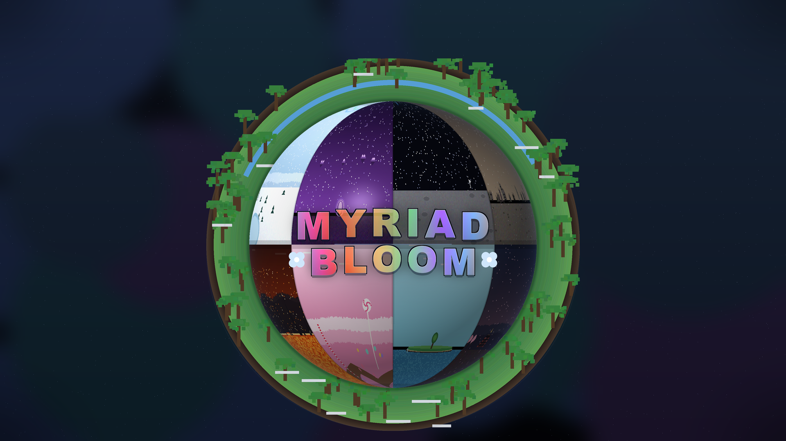

# 千花万境 · Myriad Bloom



> 状态：**已编译、已在 Minecraft 1.21.1 + NeoForge 21.1.262 专用服务器上实测通过**（验证记录见第 8 节）。

**千花万境（Myriad Bloom）** 是一个多维度大型 mod：每一个「境」都是一套独立的世界观、群系、生物与环境规则。
目前实现了第一境「**霜境**」与第二境「**糖果之境**」，后续会继续增加更多「境」。

第一个境 —— **霜境**：用雪块 + 水搭 4×4 的框，往里扔一颗钻石，就能打开通往「霜境」的传送门。
霜境是主世界的镜像（地形/河流/山脉/海岸线完全一致），但所有生物群系都换成雪地风格，时间永远停在下午。

```
雪块  雪块  雪块  雪块
雪块 水    水    雪块
雪块 水    水    雪块
雪块  雪块  雪块  雪块
```

（俯视图：一圈 12 块雪平铺在地上，中间 2×2 是水池。整个结构躺着，不立起来。）

---

## 1. 需求

| 项 | 版本 |
|---|---|
| Minecraft | 1.21.1 |
| NeoForge | 21.1.x（本工程用 21.1.262） |
| Java | **21**（系统默认若是别的版本，构建时要指定，见 2.2） |
| Gradle | 工程已带 wrapper（9.6.0） |

## 2. 构建

### 2.1 一条命令

```powershell
.\gradlew build
```

产物：`build\libs\frostrealm-1.0.0.jar`

开发期调试（会下载资源，第一次慢）：

```powershell
.\gradlew runClient
.\gradlew runServer
```

### 2.2 本机环境的两个特殊点（换机器请删掉对应配置）

**JDK**：系统 `java` 是 25，但 1.21.1 要 21。构建前指定：

```powershell
$env:JAVA_HOME = 'C:\Program Files\Java\jdk-21.0.12.1'
```

**网络**：这台机器直连 `maven.neoforged.net` 是 **TCP 层被封**（不是 DNS 污染，换 IP 也没用），
所以 `gradle.properties` 里配了走本机 Clash Verge 的代理：

```properties
systemProp.https.proxyHost=127.0.0.1
systemProp.https.proxyPort=7897
```

- 代理没开 → 构建在解析 `net.neoforged:neoform-runtime` 时超时失败
- 换到能直连外网的机器 → 删掉这 4 行即可
- 顺带把 `org.gradle.configuration-cache` 设成了 `false`，因为 ModDevGradle 的
  `createMinecraftArtifacts` 任务不兼容配置缓存

## 3. 安装

1. 服务端/客户端都装 NeoForge 21.1.x
2. jar 丢进 `mods/`
3. **两边装同一个 jar**（逻辑全在服务端，但客户端需要它带的模型和语言文件）

## 4. 怎么玩

1. 在**地面**上平铺 4×4 的雪块圈，中间 2×2 挖空灌水（就是上面那张俯视图）
2. 趁水还没冻成冰，往水里扔一颗钻石（冷群系里水会自然结冰，冰不算水，冻住就点不着了）
3. 听到地狱门点燃音效，2×2 的水变成池底一层发光的传送面（贴图/粒子/屏幕扭曲沿用原版地狱门）
4. 走进去 / 站上去 → 传送到霜境；到达侧会自动在镜像坐标建一个同款水池
5. 回程：踩进霜境那侧的传送面

**点亮之后就不用担心结冰了**：4 格水已经变成传送面本身，不是水，结不了冰；而且这层不会被雪盖住、也不会被冰替换
——上面积了雪会被立刻清掉，方块本身也写进了 `minecraft:snow_layer_cannot_survive_on` 标签。

到达侧的水池是嵌在地表里的（框架放在 `地表高度 - 1`），所以和地面齐平；传送面是 1 格深池底的一层薄面（有碰撞、能站上去），站上去就触发传送。

创造模式物品栏里有 `霜境传送门` 方块（无配方，仅供测试摆门）。

## 5. 霜境到底改了什么

| 特性 | 实现 |
|---|---|
| 地形是主世界翻版 | 生成器复用 `minecraft:overworld` 噪声设置，群系源委托原版 overworld `multi_noise`，只替换返回的群系 |
| 所有群系变雪地 | 自定义 `BiomeSource`（`frostrealm:frost_biome_source`）按映射表替换 |
| 时间恒为下午 | `dimension_type` 的 `fixed_time: 9000`（=15:00），原版地狱/末地同款机制 |
| 服务器可用 | 全部逻辑走服务端 `Portal` 接口 + 服务端事件，无客户端专属代码 |

群系映射（`FrostBiomeMap`）：

- 平原/草甸/蘑菇岛/洞穴 → `snowy_plains`（雪原）
- 森林/桦木林/黑森林/樱花林 → `grove`（雪林）
- 针叶林/丛林/沼泽 → `snowy_taiga`（积雪针叶林）
- 沙漠/恶地 → `ice_spikes`（冰刺之地）
- 风袭丘陵 → `snowy_slopes`（积雪山坡）、山峰 → `frozen_peaks` / `jagged_peaks`
- 河流 → `frozen_river`（冻河）、所有海洋 → `frozen_ocean`（冻洋，自动结冰）
- 沙滩/石岸 → `snowy_beach`
- 未知群系（含别的 mod 的）走名称猜规则，兜底 `snowy_plains`

映射目标必须出现在 `data/frostrealm/dimension/permafrost.json` 的 `snowy_biomes` 列表里。

## 6. 配置

`config/frostrealm-common.toml`：

| 键 | 默认 | 说明 |
|---|---|---|
| `enable_portal` | true | 总开关 |
| `consume_diamond` | true | 点火是否消耗钻石 |
| `portal_transition_ticks` | 0 | 站进门后多久传送（0 = 立刻） |
| `build_destination_portal` | true | 到达侧没有门时是否自动建 |
| `log_portal_events` | false | 点火/建门/传送写日志 |

## 7. 扩展接口（新道具 / 新生物 / 新环境机制）

入口都在 `com.frostrealm.api.FrostRealmApi`，不用改 mod 主类。

```java
// 道具：注册后自动进霜境创造标签页
DeferredItem<Item> crystal = ModItems.register("frost_crystal", () -> new Item(new Item.Properties()));

// 生物
DeferredHolder<EntityType<?>, EntityType<FrostWolf>> wolf = FrostRealmApi.entityTypes()
        .register("frost_wolf", () -> EntityType.Builder.of(FrostWolf::new, MobCategory.CREATURE)
                .sized(0.6F, 0.85F).build("frostrealm:frost_wolf"));

// 环境机制（纯服务端回调，异常会被捕获不会崩 tick）
FrostRealmApi.registerMechanic(new EnvironmentMechanic() {
    @Override public ResourceLocation id() { return FrostRealmApi.id("cold_drain"); }
    @Override public void onPlayerTick(ServerPlayer player) { /* 每 tick，仅霜境内玩家 */ }
    @Override public void onLevelTick(ServerLevel level) { /* 每 tick，仅霜境维度 */ }
});

// 给别的 mod 的群系也加雪地映射
FrostRealmApi.registerBiomeRemap(
        ResourceLocation.fromNamespaceAndPath("othermod", "autumn_forest"),
        ResourceLocation.withDefaultNamespace("grove"));
```

## 8. 验证记录（本次实测）

用本地专用服务器 + RCON 跑的命令式验证（脚本在 `build/tools/`，`Rcon.java` + `cmds*.txt`）：

| 验证项 | 命令 / 手段 | 结果 |
|---|---|---|
| mod 加载 | 启动日志 | `Frost Realm initialised (dimension: frostrealm:permafrost)` |
| 维度加载 | 启动日志 | `Frost Realm level ready (0 environment mechanics active)` |
| 群系替换 | `locate biome`（霜境内） | `snowy_plains` 64 格外找到、`frozen_ocean` 90 格外找到 |
| 负向对照 | `locate biome minecraft:plains` | `Could not find a biome` → 暖群系确实没漏进来 |
| 水池识别 | `fill` 铺 4×4 雪圈 + 2×2 水 | `POOL_WATER_OK` |
| 扔钻石点火 | 水里 `summon diamond` | `POOL_LIT_OK`，2×2 水变成传送门方块 |
| 跨维度传送 | 实体踩进水池（mod 自身日志） | `Portal transfer: ... -> frostrealm:permafrost` |
| 真正落地 | 传送完成回调日志 | `Frost portal arrival: ... is now in frostrealm:permafrost at {102, 62, 102}` |
| 到达侧建池 | 到达坐标 + 周边 2×2 全是传送门方块 | 自动建成，落点就是池子中心 |
| 点亮后不结冰/不被雪埋 | 在传送面上放一层雪 | `SNOW_CLEARED`（雪被立刻清掉）、`PORTAL_INTACT`（传送面完好） |
| 有碰撞后仍可传送 | 实体踩上传送面 | `Portal transfer` + `arrival` 两条日志照常出现 |
| 固定下午 | 全局 `time set midnight` 后测日光探测器 | 主世界 `power=0`（黑夜），霜境 `power=13`（下午） |

> 测试踩过的坑，记下来免得以后再犯：**`execute in <维度>` 不会限制 `@e` 的选择范围**
> （两只猪分别在主世界和霜境，两个维度查询都返回同一只），所以「某维度里有没有某实体」这类断言不可信，
> 必须用 mod 自己的日志或按坐标取方块来判定。

`run/` 目录里是这个测试世界（含已点燃的传送门、eula.txt、forceload 记录），删掉即可重新开始。

## 9. 已知限制

1. **传送面是平躺的**（按设计）。代码里保留 `axis=x/z` 的竖立面板形状和模型，但框架识别只认平铺的水池，
   竖着搭的雪框不会点火。
2. **只有没点亮的池子会结冰**：雪地群系里水池会冻成冰，冰不算「水」，`isValid` 不成立，所以必须在冻住前扔钻石；
   点亮之后免疫（见第 4 节）。想重新点，把冰挖掉重新灌水即可。
3. **门洞 2×2**，人踩进去会掉进 1 格深的池子触发传送，骑乘生物容易卡在池沿。
4. `fixed_time` 的副作用：原版 `Level#isDay()` 在固定时间维度恒为 `false`（地狱/末地同样如此），
   所以**亡灵不会在霜境白天被烧**、幻翼判定按「非白天」走。天空亮度/光照/刷怪光级是正常下午。
5. 跨维度坐标 **1:1 镜像**（`coordinate_scale = 1`）。主世界水池在地下的，霜境侧的水池建在镜像坐标地表。
6. 结构只在雪地群系参与的 tag 里生成，这是原版行为。
7. `build/tools/Rcon.java` 是测试用的小工具，不属于 mod 本体，打包时不会进 jar。
8. 村庄覆冰已实现（第 10 节），但自动计数被冻洋的自然海冰干扰，建议进游戏目视确认。

## 10. 本轮新增（暴风雪 / 温暖度 / 火之心 / 抬高传送面）

| 需求 | 实现 | 状态 |
|---|---|---|
| 传送面高度 +1 | 传送面从"池底薄面"改为**方块顶面 14–16px 的薄板**，与雪圈顶面齐平；实体站在面上即触发传送（`FrostEvents#onEntityTick` 检查脚下一格） | 已实测 |
| 天蓝材质 + 雪花粒子 | `textures/block/frost_portal.png` 是 4 帧天蓝漩涡动画（Python/Pillow 生成）+ `.mcmeta`；`animateTick` 喷 `minecraft:snowflake` | 客户端加载无警告 |
| 暴风雪、不可改变 | Minecraft 的天气是**全局**的（所有维度共用主世界天气），无法只给一个维度挂 `/weather`。改为模拟：`BlizzardMechanic` 每 2 tick 在维度内玩家周围撒大片雪花；`/weather clear` 对它无效 | 已实现 |
| 世界亮度调低 | 同上原因无法改单维度光照；用**可见距离 + 冷白雾**（`ComputeFogColor`）压暗观感 | 已实现 |
| 可见范围 -30% | 客户端 `ViewportEvent.RenderFog` 把近/远雾距离都乘 0.7 | 已实现 |
| 温暖度（火焰栏） | 10 格温暖度，同步在 `AttachmentType`（服务端权威、自动同步）；HUD 用 `RegisterGuiLayersEvent` 挂在 `food_level` 上方，10 个火焰图标 | 编译 + 客户端加载通过 |
| 温暖度机制 | 8 格内有 `#frostrealm:heat_sources`（火/营火/岩浆/岩浆块/熔炉等）时 **1 秒 +1 格**；离开 8 格 **40 秒 -1 格**；≤3 格移速 -50%（属性修饰符）；=0 每 2 秒受 `freeze` 伤害 | 已实现 |
| 火之心附魔 | 数据驱动附魔 `frostrealm:heart_of_fire`，最高 5 级，只吃护甲槽；每级 -5% 流失速度，四件叠加最高 -100%；创造栏直接给 1–5 级附魔书 | 数据包加载通过 |

配置新增（`config/frostrealm-common.toml`）：`warmth_enabled`、`heat_radius`、`warmup_ticks_per_flame`、`cool_ticks_per_flame`、`blizzard_enabled`。

生成贴图的脚本在 `build/tools/gen_textures.py`（改颜色/图案重跑即可）。

### 地形与矿物（Y-33 虚空地板 + 霜矿）

**虚空与随机基岩**：`FrostFloorFeature`（`frostrealm:frost_floor`，注册在 `raw_generation` 步骤，所以跑在原生基岩之后）：

- `Y ≤ -34` 全部变成空气 → 掉下去就是虚空
- `Y -33 ~ -30` 随机基岩：-33 恒有（1.0）、-32 是 0.7、-31 是 0.4、-30 是 0.15 → 最低可站立层是 **-33**
- 维度本身的 `min_y` 仍是 -64（要和 `minecraft:overworld` 噪声设置匹配），只是那一段被掏空了

**矿物替换**：10 个自定义生物群系 `frostrealm:frost_<原版雪地群系>`（脚本 `build/tools/gen_frost_assets.py`
从原版复制），把 `underground_ores` 里的**资源矿删掉**（保留花岗岩/闪长岩/安山岩/凝灰岩/砂砾/黏土这些石头变体与圆盘），
换上**霜矿 + 煤矿**；`FrostBiomeSource` 会优先用这些副本，找不到才回退到原版雪地群系。

**煤矿保留 90%**（玩家要靠它做火把取暖，纯靠霜矿会没火源）：原版 `ore_coal_upper` 30 脉 → 27 脉，
`ore_coal_lower` 20 脉 → 18 脉；两者都用 `discard_chance_on_air_exposure: 1.0`，
所以**任何贴着空气的煤矿立刻丢弃**——矿脉永远不会露在地表、崖壁或洞穴壁上，只能挖进去找。

**霜之石 `frostrealm:frost_ore`**：只在霜境生成，10 条矿脉/区块、每条 9 格、Y -30~96（约为原版铁矿石矿脉数的一半）。
必须**铁镐及以上**（`#minecraft:needs_iron_tool` + `requiresCorrectToolForDrops`），挖掘掉落自身。
**霜锭 `frostrealm:frost_ingot`**：熔炉烧霜之石得到（配方 200 tick / 0.7 经验）。两张贴图都是从原版铁矿/铁锭
把棕色像素按色相映射到天蓝色的，脚本可重跑。

验证（全新区块 20000,20000）：

| 检查 | 结果 |
|---|---|
| Y-40 / -50 / -64 | 全部空气（虚空）✓ |
| Y-33 | 基岩 ✓ |
| 群系 | `locate biome frostrealm:frost_snowy_plains` → 0 格外 ✓ |
| 霜矿 | 采样箱内 56 块 ✓ |
| 霜矿（另一处 Y0-30 / Y30-60） | 43 / 71 块 ✓ |
| 煤矿（Y0-30 / Y30-60） | 118 / 291 块 ✓（只在地下，永不露出） |
| 原版矿 | 铁/深板岩铁/煤/深板岩煤/钻石 **全部 0 块** ✓ |
| 熔炼配方 | 启动自检 `frost_ingot smelting recipe registered = true` ✓ |

> 配方自检没有去数「配方总数 +1」——那样会被别的模组的配方干扰。改成 `ServerStartedEvent` 里直接
> `RecipeManager#byKey(frostrealm:frost_ingot_from_smelting)` 查这条配方是否存在。

⚠️ **世界生成的改动只对新区块生效**：已有存档里已生成的区块不会重算地形和矿物（想完全体验建议开新世界，
或者只在霜境未探索区域活动）。


### 霜岩：点亮后的框架不可破坏

点火的那一瞬间，构成水池框架的 **12 块雪块会被替换成 `frostrealm:frost_rock`（霜岩）**：

- 贴图是原版黑曜石按**亮度重映射到天蓝**（保留了黑曜石的纹理旋纹），生成脚本见 `build/tools/gen_frost_assets.py`
- `strength(-1.0F, 3600000.0F)` —— 和基岩同款，生存模式挖不掉、炸不掉；另外写进
  `#minecraft:dragon_immune` 和 `#minecraft:wither_immune`，末影龙/凋灵也拆不了
- **框架校验同时接受雪块和霜岩**（`isRingMaterial`），否则点亮后门就不再被识别、来回传送会重复建门
- 到达侧自动生成的水池直接用霜岩砌框，一次成型

验证：点火后环上三个取样点都是 `frostrealm:frost_rock`、`RING_STILL_SNOW` 不触发；
随后猪传送 `Portal transfer` + `Frost portal arrival {302, 63, 302}` 正常。

> 测试时踩过一个坑：把猪 `summon` 在**方块内部**（y 64.5，而传送面在方块顶部 14–16px）不会触发传送；
> 站在面上（正常玩法）才触发。这不是 bug，是我的测试摆位不对。


### 村庄：覆冰 + 村民 -90%

用自定义 `StructureProcessor`（`frostrealm:frosty_village`）实现，挂在**所有**村庄模板池的每个建筑元素上
（脚本 `build/tools/gen_village_pools.py` 从原版数据生成 59 个池覆盖，共 71 个池文件在 jar 里）：

- **覆冰**：建筑里每个被放置的方块有 `probability`（默认 **0.4**）概率**替换成冰**——不是盖在上面，是替换。
  空气、结构空位、jigsaw 方块永远跳过（替换 jigsaw 会直接破坏结构生成）。
- **村民 -90%**：村民是模板里的实体标记，所以用同一个处理器的 `processEntity` 按 `villager_removal_chance`（默认 **0.9**）丢弃。
- **只影响霜境**：处理器内部检查 `WorldGenLevel.getLevel().dimension()`，主世界村庄保持完全原版，
  所以才能放心地全局覆盖模板池。
- 随机数是**按方块坐标**算的，重建同一区块结果一致。

概率想改就改池 JSON 里的 `probability` / `villager_removal_chance`（在 `data/minecraft/worldgen/template_pool/...`）。

验证情况：数据包加载无错误；主世界同类村庄区域统计到 **0 块冰**（村庄存在，34 块木板），说明维度门控正确；
霜境村庄区域统计到大量冰，但取样点紧邻冻洋，自然海冰干扰了计数——最直观的确认还是进游戏飞一圈看村庄。

## 11. 传送门 V2：独立天气、蓄力动画、框架回退

### 独立天气（真·每维度天气）

原版天气是**全局**的（`LevelData` 只有一份，其他维度用 `DerivedLevelData` 代理），所以 `/weather` 必然全服生效。
但所有天气效果最终都走两个 getter：`Level#getRainLevel` / `getThunderLevel`（`isRaining()` 就是 `getRainLevel(1) > 0.2`，
天空变暗、降水 tick、客户端的雨雪渲染也都读它们）。因此加了 mixin `LevelWeatherMixin`：

```java
@Inject(method = "getRainLevel", at = @At("HEAD"), cancellable = true)
```

只对霜境返回 `1.0` → 霜境永久雷暴（真雨雪 + 天空变暗 + 雪层堆积），主世界天气完全不受影响，
`/weather clear` 也关不掉霜境的风暴。部署文件：`frostrealm.mixins.json` + mods.toml 里的 `[[mixins]]`。

验证：`weather_check` 谓词在霜境 `raining=true` / `thundering=true` 都为真，主世界为假；
启动日志里有 `Mixing LevelWeatherMixin ... into net.minecraft.world.level.Level`。

### 蓄力动画（3 秒，中途离开取消）

不再一踩就传：

- 站在传送面上开始**蓄力**：每 2 tick 在自身周围喷雪花，半径 0.35 → 1.4 逐渐扩大、数量 2 → 8 递增，
  蓄满时 40 粒爆发 + `portal_trigger` 音效，然后才传送
- 蓄力时长 = 配置项 `portal_transition_ticks`（默认 **60 tick = 3 秒**）
- **中途离开立刻取消**（进度归零）
- 到达后被"解除武装"（`armed=false`）：必须**先离开**传送面才能再次蓄力，所以进维度后待着不动不会被弹回去
- 到达时清掉原版复制过来的 `portalProcess`（`Entity#restoreFrom` 会连它一起复制，
  这正是之前"待在原地被反复传送"的根因）

验证：猪蓄力约 3 秒后传送 1 次；在原地站 25 秒**零新增传送**。

### 门被破坏 → 框架回退成雪

`FrostRockBlock` 在邻居更新/随机 tick 时检查周围是否还有**完整且点亮**的 2×2 传送面：

- 传送面缺任何一格 → 剩下的传送方块自我塌缩成空气（`FrostPortalBlock#collapseIfBroken`）
- 框架失去完整门 → 霜岩回退成**雪块**（可破坏），拆掉的门不会在地表留下无法清除的痕迹
- 传送面本身改成可破坏（`strength(0.5F)` + 空战利品表，挖掉不掉落），方便自己拆门

验证：`setblock` 挖掉一格传送面后 → `RING_REVERTED_TO_SNOW` 触发、`PORTAL_STILL_LIT` 不再触发。
